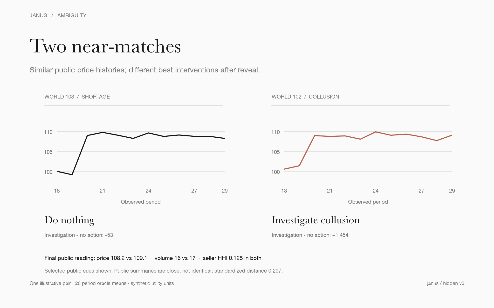
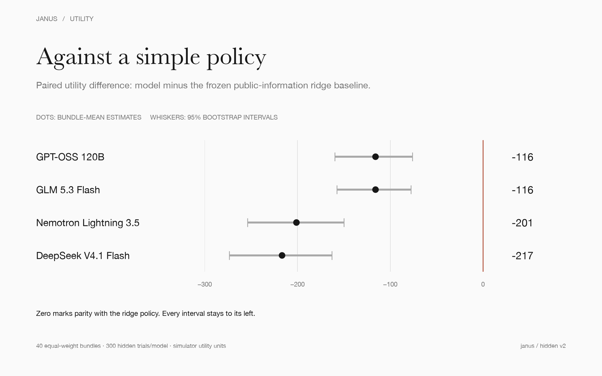
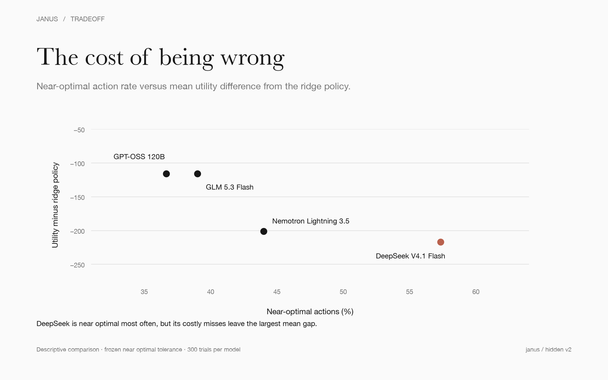

# Janus

An outcome-based benchmark for testing whether language models can make public-policy
decisions when similar evidence can have different underlying causes.

Janus places a model in the role of a regulator in a synthetic market. The model sees
only public aggregate data, makes one diagnosis, and chooses one of five interventions.
The environment then evaluates every available action from the same decision state.
There is no LLM judge: decisions are scored by their simulated consequences.

[Benchmark card](BENCHMARK.md) · [v2 charter](docs/v2/CHARTER.md) ·
[Frozen results](reports/v2-publication) · [Research specification](PROJECT_SPEC.md) ·
[Contributing](CONTRIBUTING.md)



## Why this benchmark exists

Public policy is rarely a clean question-answering task. A price increase may reflect a
supply shortage, stronger demand, seller coordination, or momentum buying. Those causes
can produce similar public signals while making the same intervention helpful in one case
and harmful in another.

Most language-model evaluations do not capture that structure. They score a response for
factual correctness, style, or agreement with a judge. Janus instead asks a narrower and
more consequential question:

> Given incomplete public evidence, can a model choose an action with low economic regret?

The benchmark separates two sources of failure:

```text
oracle - model = (oracle - public-information policy)
               + (public-information policy - model)
                 information loss                 decision loss
```

This matters because uncertainty about an unobserved mechanism is not automatically a
reasoning failure. The model should be compared both with a full-information oracle and
with a strong policy that must act on the same public information.

## The experiment

Each evaluation case contains:

- one synthetic single-commodity double-auction market;
- one of four hidden mechanisms: supply shortage, demand increase, seller collusion, or
  momentum demand;
- 30 periods of public observations before the decision;
- one structured diagnosis and one intervention choice; and
- 20 post-decision periods evaluated under common future disturbance tapes.

The five possible actions are:

1. do nothing;
2. impose a price cap;
3. apply a transaction tax;
4. subsidize supply; or
5. investigate collusion.

The simulator clones the decision state and runs every action against matched future
disturbances. This produces an outcome-based utility for the chosen action, the best
full-information action, and the frozen public-information comparator.

The v2 hidden set contains 40 independent ambiguity bundles, 160 worlds, and 300 trials
per model. Worlds and repeated calls inside a bundle are repeated measurements; the
bundle is the unit of statistical independence.

## Frozen v2 result

Four open-weight models were served through the same Fireworks configuration with the
same prompt, schema, observations, replicate schedule, and no harness retries.

Model | Utility difference vs. ridge policy | 95% bundle interval | Near-optimal action rate
--- | ---: | ---: | ---:
GPT-OSS 120B | -115.9 | [-159.6, -76.0] | 36.7%
GLM 5.3 Flash | -116.0 | [-157.5, -77.7] | 39.0%
Nemotron Lightning 3.5 30B-A3B | -201.3 | [-253.8, -150.0] | 44.0%
DeepSeek V4.1 Flash | -216.9 | [-273.6, -162.7] | 57.3%

A negative primary estimate means the model underperformed the frozen ridge policy. That
policy used only public observations at decision time, but it was fit on development-world
oracle utility labels. It is a task-specific learned comparator, not a human baseline or a
proof of the best possible public-information policy.



The most interesting result is not a model ranking. DeepSeek chose a near-optimal action
most often while having the largest mean utility shortfall. In this environment, counting
how often a decision is approximately right can obscure the cost of the mistakes.



All four models completed at least 97.3% of hidden trials with a valid scored response.
Paid smoke, development, and hidden inference cost $1.1135 in total. Full calibration,
action, risk-coverage, economic-outcome, operational, and sensitivity tables are in
[`reports/v2-publication`](reports/v2-publication).

## What the result means

Janus v2 provides evidence about four pinned model endpoints on one synthetic benchmark.
It does not establish that a model can or cannot regulate a real economy.

The result supports three narrower observations:

- outcome-based evaluation can distinguish action frequency from the cost of error;
- a compact task-specific policy can be a demanding comparator for a general-purpose LLM;
  and
- causal ambiguity should be measured rather than quietly counted as model failure.

There is no human baseline, no frontier closed-model comparison, and no external independent
replication yet. The environment contains one market design, one decision, five fixed
actions, and a synthetic welfare function. These are deliberate constraints for a first
inspectable release, not claims of ecological validity.

## Quick start

Janus requires Python 3.12 or newer and uses `uv` for the locked environment.

```bash
git clone https://github.com/fawzmehfil/Janus.git
cd Janus
uv sync --all-groups
uv run pytest
```

Run a local end-to-end v2 dry run without an API key:

```bash
uv run janus v2-dry-run --output artifacts/v2-dry-run
```

Regenerate the frozen public tables and vector figures:

```bash
uv run janus v2-publication
```

Paid collection is intentionally guarded. It requires `FIREWORKS_API_KEY`, an explicit
budget ceiling, an exact confirmation phrase, and one frozen model role at a time. Start
with the documented procedure rather than invoking a live command directly:

- [`docs/v2/LIVE_FIREWORKS_COLLECTION.md`](docs/v2/LIVE_FIREWORKS_COLLECTION.md)
- [`docs/v2/RELEASE_CHECKLIST.md`](docs/v2/RELEASE_CHECKLIST.md)

Runnable local and publication recipes are collected in [`examples/`](examples).

## Repository map

Path | Purpose
--- | ---
`src/janus/` | Simulator, scenario generation, policies, providers, analysis, and CLI
`tests/` | Analytic, property, regression, and integration tests
`configs/` | Frozen prompts, schemas, model roles, pricing, and experiment settings
`manifests/` | Public and committed benchmark manifests
`docs/` | Design decisions, protocols, review records, and v2 procedures
`reports/v2-publication/` | Deterministically generated public tables and figures
`assets/` | Stable images for the repository and public communication
`examples/` | Short paths through local evaluation and result reproduction
`artifacts/` | Local run output; ignored by default except frozen release evidence

## Technical shape

Layer | Implementation
--- | ---
Market | Deterministic periodic double auction with scripted participants
Ambiguity | Matched bundles spanning four latent causal mechanisms
Decision | One diagnosis and one of five fixed interventions
Counterfactuals | Cloned state, common random numbers, all-action evaluation
Comparators | Fixed actions, heuristics, ridge policies, and full-information oracle
Inference | Bundle-level paired estimates and hierarchical bootstrap intervals
Model I/O | Versioned prompt and strict structured response schema
Collection | Provider-neutral harness with budget stops, resume, and no silent retries
Reproduction | Locked Python environment, frozen manifests, hashes, tables, and SVG figures

## Research status

Janus is a beta research benchmark. The v2 measurement is complete and frozen; future
changes to market mechanics, prompts, actions, utilities, or hidden distributions require a
new benchmark version. The immediate research priorities are a preregistered human baseline,
independent replication, additional market environments, abstention and tool-use variants,
and evaluation of hybrid systems that combine language models with explicit causal and
optimization components.

## Citation and license

Citation metadata is in [`CITATION.cff`](CITATION.cff). Janus is released under the
[`MIT License`](LICENSE).
