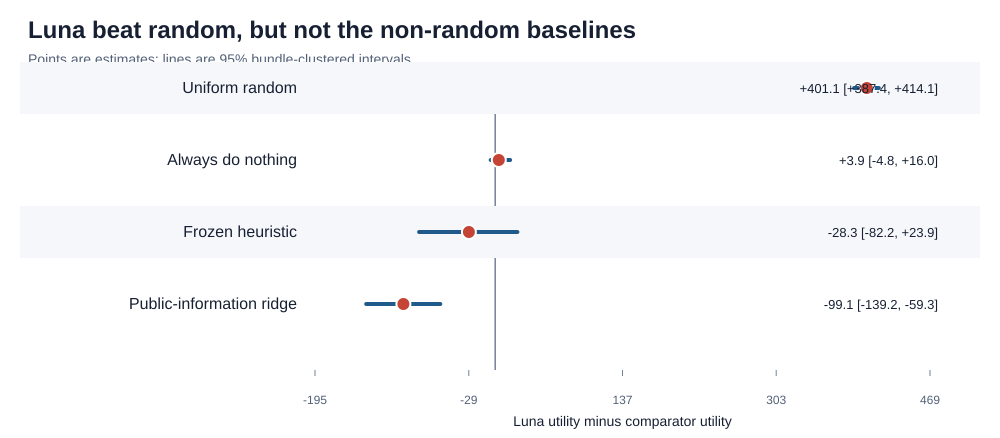
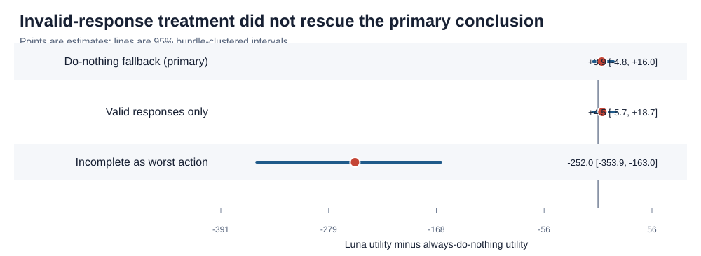
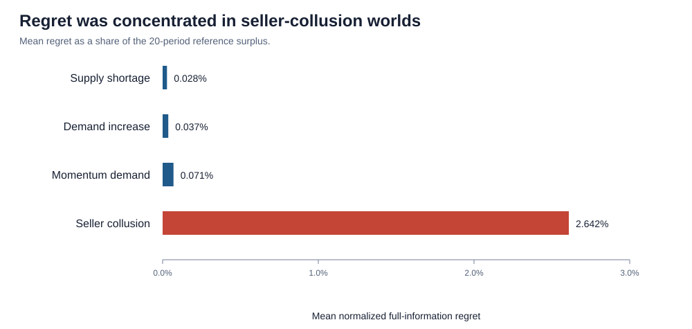
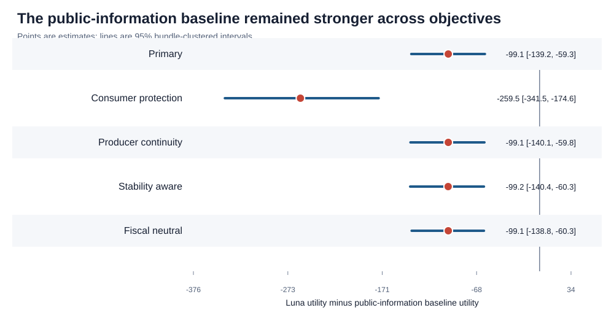

# Janus hidden-v1: final research report

- **Evaluation date:** 2026-10-19
- **Model:** `gpt-6-luna`
- **Sealed response commit:** `95b6b9b`
- **Sample:** 25 ambiguity bundles, 100 worlds, 300 planned model calls

## Abstract

Janus tests whether a language model can choose one welfare-improving market
intervention from public evidence when four different hidden mechanisms produce
similar price and quantity histories. On 100 sealed synthetic worlds with three
independent model calls per world, GPT-6 Luna decisively outperformed uniform
random action selection but did not reliably outperform always doing nothing or
the frozen handwritten heuristic. It underperformed a ridge policy trained on
the same public information by 99.07 utility units (95% bundle-clustered
interval: 59.28 to 139.21 units worse). Failures were concentrated in
seller-collusion and out-of-distribution (OOD) worlds. These conclusions concern
one frozen synthetic benchmark, prompt, model alias, and evaluation window; they
are not evidence that an LLM should regulate a real market.

## Research question and design

The regulator observed only a versioned table of public aggregate market
history. It chose one of five fixed actions: do nothing, impose a price ceiling,
levy a transaction tax, subsidize supply, or investigate collusion. Scripted
participants then responded for 20 recovery periods. A local counterfactual
simulator evaluated every action from the identical cloned state under the same
indexed future disturbances. No LLM judge or human grader determined the score.

The hidden set contained 25 ambiguity bundles. Each bundle held one matched
world from each latent family—supply shortage, demand increase, seller
collusion, and momentum demand—for 100 worlds total. Sixty worlds were drawn
in-distribution and 40 from preregistered OOD ranges. Three model replicates per
world produced 300 planned calls. The bundle, not the model call, was the
independent unit: every reported 95% interval used 10,000 bootstrap samples that
resampled ambiguity bundles while preserving nested worlds and replicates.

## Protocol integrity and cost

Collection used `gpt-6-luna` through the Responses API with high reasoning,
strict structured output, a 2,048-token output allowance, no SDK retries, no
repair calls, no provider storage, and no prompt-cache writes. All 300 planned
requests were made and retained. The response manifest and 300 raw/parsed
artifacts were hashed, secret-scanned, and committed as `95b6b9b` before hidden
labels or oracle outcomes were opened.

The hidden run cost `$0.3367435`; cumulative live spend including development
smokes was `$0.3475366`, below the explicitly approved `$0.84` cumulative cap.
The provider reported 1,325,395 input tokens, 408,408 output tokens, and 364,293
reasoning tokens, with zero cached-input or cache-write tokens.
The analysis verified the public and private manifests, seed commitment, every
response hash, and all 100 primary oracle hashes.

## Primary results

The preregistered intention-to-evaluate analysis assigned the frozen
`do_nothing` fallback to incomplete outputs.

| Metric | Estimate | 95% bundle-clustered interval |
|---|---:|---:|
| Mean normalized full-information regret | 0.00695 | [0.00456, 0.00944] |
| Epsilon-optimal action rate | 55.0% | [48.7%, 61.3%] |
| Utility difference vs uniform random | +401.15 | [+387.40, +414.06] |
| Utility difference vs always do nothing | +3.88 | [-4.82, +16.03] |
| Utility difference vs frozen heuristic | -28.35 | [-82.15, +23.91] |
| Utility difference vs public-information ridge | -99.07 | [-139.21, -59.28] |

Mean model utility was 16,959.24, compared with 16,558.09 for uniform random,
16,955.36 for always doing nothing, 16,987.58 for the heuristic, 17,058.31 for
the public-information ridge, and 17,075.91 for the full-information oracle.
Median normalized regret was zero. The estimated oracle-minus-public-information
gap was only 17.60 utility units; the public-information-minus-model decision
gap was 99.07. Thus partial observability did not explain most of the model's
shortfall.

The best constant action on this hidden set was `collusion_investigation`, with
mean utility 17,033.44. This is descriptive rather than a deployable baseline
because it uses the hidden-set action prior, but it reinforces that Luna's
near-default policy was not competitive.

## Incomplete-response sensitivity

Of 300 responses, 256 (85.3%) were directly schema-valid. Forty-four (14.7%)
ended `incomplete` because the output allowance was exhausted; there were no
refusals, timeouts, schema failures, empty responses, repairs, or cache writes.
The corrected five-world smoke did not reveal this failure rate.

| Scoring rule | Trials | Difference vs do nothing | Difference vs public-information ridge |
|---|---:|---:|---:|
| Do-nothing fallback (primary) | 300 | +3.88 [-4.82, +16.03] | -99.07 [-139.21, -59.28] |
| Valid responses only | 256 | +4.55 [-5.68, +18.65] | -59.31 [-91.68, -30.70] |
| Incomplete as worst action | 300 | -252.03 [-353.92, -163.04] | -354.98 [-482.29, -235.45] |

The valid-only analysis is conditional on successful completion and is not a
replacement for the intention-to-evaluate result. The worst-action analysis is
deliberately adversarial: each incomplete response receives the lowest-utility
allowed action in its own world. Together they bound how much the operational
failure treatment can influence the conclusion.

## Distribution shift and failure concentration

| Split or family | Mean normalized regret | Epsilon-optimal | Valid response rate |
|---|---:|---:|---:|
| ID | 0.00197 | 57.8% | 91.7% |
| OOD | 0.01440 | 50.8% | 75.8% |
| Supply shortage | 0.00028 | 84.0% | 81.3% |
| Demand increase | 0.00037 | 69.3% | 94.7% |
| Momentum demand | 0.00071 | 60.0% | 96.0% |
| Seller collusion | 0.02642 | 6.7% | 69.3% |

OOD minus ID normalized regret was 0.01243, with a 95% interval from 0.01104
to 0.01373. Seller-collusion regret was roughly 37 times momentum-demand regret
and 93 times supply-shortage regret. Luna selected `collusion_investigation`
only three times overall. Under the primary fallback rule its 300 actions were
251 `do_nothing`, 44 `transaction_tax`, three `collusion_investigation`, two
`price_ceiling`, and zero `supply_subsidy`.

The five highest-regret model trials were all seller-collusion cases. This
concentration, plus the lower OOD completion rate, makes the aggregate result
look more benign than the model's main causal failure mode.

| World / replicate | Status | Selected action | Regret | Normalized regret |
|---|---|---|---:|---:|
| `janus-hidden-world-005` / `00` | Valid | Transaction tax | 1,424.81 | 0.08481 |
| `janus-hidden-world-005` / `02` | Incomplete | Do nothing fallback | 1,404.30 | 0.08359 |
| `janus-hidden-world-068` / `00` | Incomplete | Do nothing fallback | 1,141.16 | 0.06793 |
| `janus-hidden-world-068` / `01` | Incomplete | Do nothing fallback | 1,141.16 | 0.06793 |
| `janus-hidden-world-068` / `02` | Incomplete | Do nothing fallback | 1,141.16 | 0.06793 |

All five were OOD seller-collusion trials. The table is descriptive: repeated
calls on the same world are not treated as independent evidence.

## Robustness to welfare assumptions

The four alternative objectives—consumer protection, producer continuity,
stability awareness, and fiscal neutrality—were frozen before collection.
Consumer protection doubles the consumer-surplus weight; producer continuity
subtracts 50 utility units per seller exit; stability awareness subtracts 100
times realized log-price volatility; and fiscal neutrality removes the primary
objective's marginal public-financing penalty while retaining real costs.
After responses were sealed, every hidden state was replayed locally for all
five actions using the original 256 indexed disturbance tapes. Each replay
yielded the complete utility vector. Recomputed primary action means matched
all 100 frozen primary oracles within `1e-9`; no provider call was made.

| Welfare objective | Difference vs random | Difference vs do nothing | Difference vs public-information ridge |
|---|---:|---:|---:|
| Primary | +401.15 [+387.40, +414.06] | +3.88 [-4.82, +16.03] | -99.07 [-139.21, -59.28] |
| Consumer protection | -270.42 [-302.83, -239.73] | -47.86 [-69.95, -24.74] | -259.48 [-341.46, -174.59] |
| Producer continuity | +401.15 [+387.32, +414.19] | +3.88 [-4.71, +16.10] | -99.07 [-140.08, -59.79] |
| Stability aware | +401.17 [+387.62, +414.22] | +3.88 [-4.71, +16.30] | -99.18 [-140.39, -60.33] |
| Fiscal neutral | +113.81 [+101.35, +126.04] | +3.88 [-4.72, +15.94] | -99.07 [-138.84, -60.34] |

These analyses re-score the fixed Luna, heuristic, and ridge actions under each
objective. They do not retrain an objective-specific ridge policy, so the
public-information comparison asks whether the already frozen observation-only
policy remains preferable under alternative values—not whether it is the best
possible policy for each alternative objective.

The main comparison with the public-information baseline was robust: Luna was
reliably worse under all five welfare objectives. It also failed to establish a
positive advantage over doing nothing under every objective. The comparison
with uniform random was not normatively robust. Luna remained better under the
primary, producer-continuity, stability-aware, and fiscal-neutral objectives,
but was reliably worse when consumer surplus received double weight. This
reversal reflects the cost of Luna's predominantly inactive policy when the
objective places greater value on consumer protection.

## Diagnosis, confidence, and repeated-call behavior

Diagnosis accuracy was exactly 25.0% when incomplete responses were retained as
incorrect (95% interval: 23.3% to 26.7%) and 29.3% among valid responses. Luna
labeled 250 of 256 valid responses as `momentum_demand`, so the diagnosis field
did not recover the four-way hidden cause.

Confidence was positively associated with epsilon-optimality: the clustered
correlation was 0.357 (95% interval: 0.239 to 0.469). Mean action agreement
within a world was 86.7%, and 61% of worlds received the same action on all
three calls. Confidence therefore carried some ranking information even though
the causal diagnosis collapsed.

## Preregistered hypotheses

| Hypothesis | Result |
|---|---|
| H1: higher utility than uniform random | Supported |
| H2: higher utility than always do nothing | Not supported |
| H3: OOD increases regret | Supported |
| H4: confidence positively tracks epsilon-optimality | Supported |
| H5: diagnosis accuracy exceeds chance | Not supported |

## Interpretation

The central result is narrow but clear. Luna was not random: it avoided the
most damaging actions often enough to produce a large, precisely estimated
gain over uniform choice. But it mostly defaulted to inaction and did not show
a reliable advantage over doing nothing. More importantly, it left a large,
precisely estimated gap to a simple policy using the same public information.
That pattern points to decision failure, not merely unavoidable ambiguity.

The failure was causal and distributional rather than uniform. Conservative
inaction was frequently adequate in shortage and demand worlds, but it was a
poor response to seller collusion. The model rarely invoked the targeted
investigation and its diagnosis almost always named momentum demand. OOD worlds
then amplified both regret and output incompleteness.

## Limitations

- Janus is a stylized single-good, one-decision simulator with scripted agents;
  it is not a model of any real economy or institution.
- The hidden pilot has 25 independent ambiguity bundles. Aggregate paired
  effects are more credible than fine-grained family rankings.
- The provider returned a stable alias rather than a dated model snapshot, so
  exact future replication may be affected by model drift.
- A 14.7% token-exhaustion rate is a material operational limitation. Raising
  the allowance and rerunning hidden-v1 would violate its one-use protocol; a
  future benchmark version should preregister a larger allowance.
- The alternative-objective analysis changes welfare scoring, not the market
  institution, intervention magnitudes, horizon, or hidden-world prior.
- The public-information ridge is a strong fitted baseline, not a proven Bayes
  oracle.

## Reproducibility and artifacts

The sealed response commit is `95b6b9b`. Machine-readable primary and
sensitivity reports are stored in `artifacts/hidden-v1-analysis/`. CSV source
tables, accessible SVG figures, and their source-hash manifest are under
`reports/hidden-v1-publication/`. The exact local commands are documented in
`docs/HIDDEN_EVALUATION.md`. All sensitivity and publication steps run without
an API key or network access.
